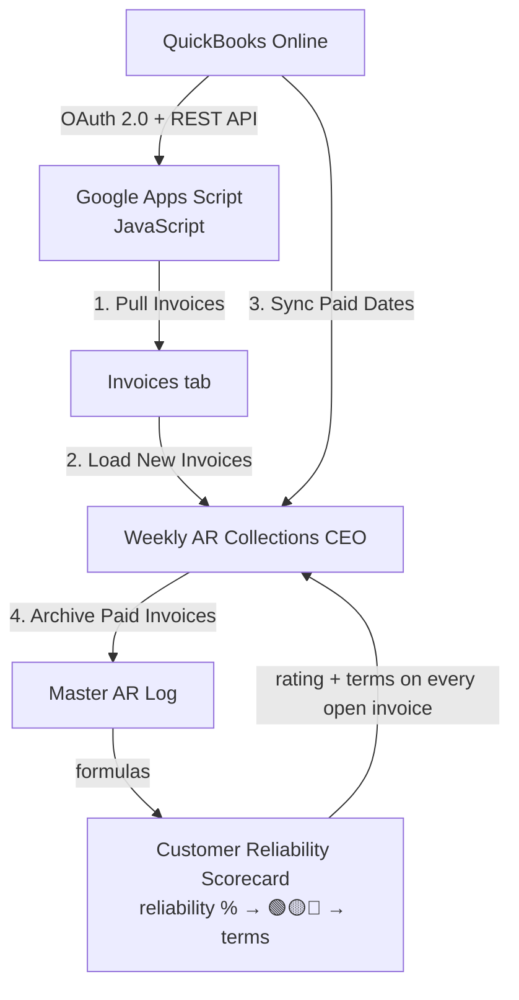
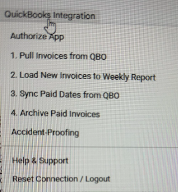

# Collection Operating System

**The point of this system is to rate every customer on how reliably they pay, calculate their risk rate, and use that rating to decide how hard to follow up with them and what payment terms and pricing to offer them next time.**

This is the accounts-receivable (AR) collections system I designed and built. It has two parts:

1. **A QuickBooks Online integration** written in JavaScript (Google Apps Script). It pulls invoices and payments straight from QuickBooks into Google Sheets.
2. **A customer-rating workbook** that turns every payment into an on-time reliability rate, a 🟢 / 🟡 / 🔴 risk rating, and recommended terms for that customer's next order.

> 📊 **Workbook:** [`sample/Collections-Operating-System.xlsx`](sample/Collections-Operating-System.xlsx). Its first tab, **QuickBooks Integration**, documents the whole process.
> 💻 **Script:** [`src/Code.gs`](src/Code.gs)
> The structure, formulas and code are the real ones. **The data covers 255 customers, shown as codes `CUST-001` … `CUST-255`, and 1,300 paid invoices. All invoice numbers and amounts are fictional.**

---

## How it works

---

## Part 1: the QuickBooks integration (JavaScript)

The script adds a **QuickBooks Integration** menu to Google Sheets:

| Menu item | JavaScript function | What it does | Tab it updates |
|---|---|---|---|
| **Authorize App** | `startOAuthFlow()` → `doGet()` | Opens the Intuit login. After approval, Intuit redirects back to the script's web app. The app swaps the one-time code for access and refresh tokens and stores them in Script Properties. | — |
| **1. Pull Invoices from QBO** | `fetchInvoices()` | Queries every open Invoice and Credit Memo (1,000 per page), sorts them by customer, writes the list with a grand total, and highlights overdue due dates. | Invoices |
| **2. Load New Invoices to Weekly Report** | `loadNewInvoicesToWeeklyReport()` | Adds invoices due in the next 14 days or already past due (balance over $2) that aren't on the report yet. Adds the Status dropdown and the Risk Rating / Recommended Terms lookups, then sorts by due date. | Weekly AR Collections (CEO) |
| **3. Sync Paid Dates from QBO** | `syncPaidDatesFromQBO()` | Asks QuickBooks which invoices are now fully paid, finds the Payment applied to each one, marks the row **Paid** and writes the real payment date. Warns about rows marked Paid that QuickBooks doesn't show as paid. | Weekly AR Collections (CEO) |
| **4. Archive Paid Invoices** | `closeOutLastWeek()` | Moves confirmed-paid rows to the Master AR Log. Refuses rows that QuickBooks still shows open, and never logs the same invoice twice. **This is what feeds the customer ratings.** | Master AR Log |
| **Accident-Proofing** | `buildModernCEODashboardHeader()` | Rebuilds the six KPI tiles and their live formulas if someone breaks the top of the report. | Weekly AR Collections (CEO) |
| **Audit Master AR Log** | `auditMasterARLog()` | Highlights duplicate rows, and rows logged as paid that QuickBooks still shows open. Deletes nothing. | Master AR Log |
| **Reset Connection / Logout** | `clearOAuthTokens()` | Revokes the token at Intuit and clears the stored credentials. | — |

### How the connection works (OAuth 2.0)

1. **Authorize:** the script builds an Intuit login link with a random one-time `state` value (CSRF protection) and the `com.intuit.quickbooks.accounting` scope.
2. **Callback:** Intuit redirects to the script's web app. `doGet()` checks that the `state` matches, then saves the company ID (`realmId`).
3. **Tokens:** the code is exchanged for an access token (valid about 1 hour) and a refresh token. Both are kept in **Script Properties**, never in the sheet or the code.
4. **Auto-refresh:** `getValidAccessToken()` refreshes the token 60 seconds before it expires, with a lock so two clicks can't refresh at the same time.

### QuickBooks API queries

| Purpose | Query |
|---|---|
| Open invoices | `SELECT * FROM Invoice WHERE Balance > '0.00'` |
| Open credit memos | `SELECT * FROM CreditMemo WHERE Balance > '0.00'` |
| Recently paid invoices | `SELECT * FROM Invoice WHERE Balance = '0.00' AND MetaData.LastUpdatedTime >= '<60 days ago>'` |
| Payment dates | `SELECT * FROM Payment WHERE TxnDate >= '<60 days ago>'` (linked to invoices to get the real paid date) |

All queries page through results with `STARTPOSITION` / `MAXRESULTS` (`qboQueryAll()`), so large accounts aren't cut off at QuickBooks' 100-row default.

### Setup (for your own QuickBooks company)

1. Create an app at [developer.intuit.com](https://developer.intuit.com) with the `com.intuit.quickbooks.accounting` scope.
2. In Google Sheets, open **Extensions → Apps Script** and paste in `src/Code.gs`.
3. Deploy it as a **Web App** and copy the URL.
4. In **Project Settings → Script Properties**, add `CLIENT_ID`, `CLIENT_SECRET` and `REDIRECT_URI` (the Web App URL). Optionally add `SUPPORT_CONTACT`, the contact shown under Help & Support.
5. Add the same URL as a Redirect URI in the Intuit portal, reload the sheet, then click **QuickBooks Integration → Authorize App**.

> Anyone with edit access to the spreadsheet can read Script Properties, which hold the credentials, so only give edit access to people you trust with your books.

---

## Part 2: customer ratings

### How a customer gets rated

1. **Every paid invoice is logged** in the **Master AR Log** with its promised date and the date it was actually paid.
2. **On Time?** = `Yes` if it was paid on or before the promised date. **Days Variance** = how many days late it was.
3. **Risk rate:** **On-Time Reliability % = on-time payments ÷ total invoices paid**, per customer.
4. **The color sets how hard to follow up, and the band inside each color sets the terms:**

| Rating | On-Time Reliability % | Recommended Terms / Pricing | Follow-up |
|---|---|---|---|
| 🟢 Green | **90% or more** | **Standard Terms + 2% early-payment discount** | Email reminder before the due date |
| 🟢 Green | **80% – 89%** | **Standard Terms** | Email reminder before the due date |
| 🟡 Amber | **65% – 79%** | **Net 15** | Phone call to confirm date, amount and payment method |
| 🟡 Amber | **50% – 64%** | **Net 15 + 25% deposit on new orders** | Phone call to confirm date, amount and payment method |
| 🔴 Red | **30% – 49%** | **COD** (cash on delivery) | Phone call, escalate to the owner |
| 🔴 Red | **Under 30%** | **CIA** (cash in advance) | Phone call, escalate, hold new orders |

Every customer's rating and terms update automatically each time an invoice is archived. The terms also appear on the weekly report next to every open invoice, so the team sees them before quoting or shipping the next order.

### Customer codes
Customers are identified by **customer codes** (`CUST-001` … `CUST-255`) instead of names, on every tab. The sample Master AR Log holds **1,300 paid invoices**, so the Scorecard rates **255 customers** across all six term tiers.

---

## The workbook tabs

| Tab | Purpose |
|---|---|
| **QuickBooks Integration** | Documentation of the integration: data flow, the menu and its JavaScript functions, OAuth, API queries, rating rules and the weekly routine |
| **Weekly AR Collections (CEO)** | One-page weekly report: six KPI tiles plus every invoice due in the next 14 days or past due, with each customer's live rating and terms |
| **Customer Reliability Scorecard** | Builds itself from the Master AR Log: total invoices, on-time payments, missed promises, **reliability %**, average days late, **risk rating**, **recommended terms** |
| **Master AR Log** | Permanent history of paid invoices (1,300 in the sample); **On Time?** and **Days Variance** are calculated |
| **Invoices** | The open invoices and credit memos pulled from QuickBooks, with a grand total |

### KPI tiles on the CEO report

| Tile | What it shows |
|---|---|
| **Expected This Week** | Open invoices expected to be paid this week |
| **Confirmed (🟢)** | The part owed by 🟢 customers |
| **At Risk (🟡 + 🔴)** | Expected minus Confirmed |
| **Last Week Promised** | Everything customers promised to pay last week |
| **Collected Last Week** | What was actually paid last week |
| **Variance** | Promised minus Collected: broken promises |

**Status dropdown values:** Confirmed · Promised · Approved · In process · Disputed · Unresponsive · Not contacted · Paid

### Weekly routine

| When | Menu steps | Result |
|---|---|---|
| Monday | **1. Pull Invoices → 2. Load New Invoices** | This week's collection list, with every customer rated |
| Tue – Thu | Work the list, 🔴 and 🟡 first | Statuses, expected dates and notes updated |
| Friday | **3. Sync Paid Dates → 4. Archive Paid Invoices** | Paid invoices logged; every customer re-rated automatically |

---

## Opening the workbook

**Use Google Sheets:** File → Import → Upload → *Replace spreadsheet*. The Scorecard uses Google Sheets array formulas (`SORT`, `UNIQUE`, `FILTER`, `MAP`, `LAMBDA`), so Excel shows those columns as static values instead of recalculating them.

> Excel limits tab names to 31 characters, so two tabs are named **Weekly AR Collections (CEO)** and **Customer Reliability Scorecard**.
